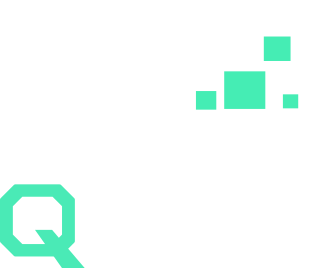

<div align="center">



# QMine

**Vein mining, excavation shapes, and bulk harvesting for Fabric, Forge, and NeoForge.**

[](https://www.gnu.org/licenses/agpl-3.0.html)

</div>

---

QMine is a configurable vein mining and excavation mod for Minecraft **1.20.1**, **1.21.1**, and **26.3** across **Fabric**, **Forge**, and **NeoForge**.

It works both client-side and server-side:
- **Client + Server**: Live in-world outlines, HUD overlay, and scroll-wheel shape selection.
- **Server only**: Unmodified vanilla clients can join and vein mine by sneaking.

---

## Features

### Vein Mining
- **Connected blocks**: Breaks matching connected ores, wood, and dirt clusters up to the configured limit.
- **Merge tags**: Groups variant blocks together so regular and deepslate ores break in one pass.
- **Pitch scaling sound**: Block break sounds adjust pitch as larger veins are cleared.
- **Vanilla client support**: Server players without the mod installed can sneak while mining to trigger vein mining.

### Shapes
Cycle shapes by holding `~` and scrolling, or using the arrow keys:
- **Shapeless**: Connected vein search for ores and clusters.
- **Tunnel**: Straight rectangular tunnels forward from the targeted block face.
- **Mining Tunnel**: Standard 1x2 tunnel.
- **Miner Passage**: 1x3 tunnel with extra head clearance.
- **Staircase**: Stepped tunnels heading upward or downward.
- **Escape Tunnel**: Upward-sloping stairway for digging out to the surface.
- **Strip Miner**: Mines parallel exploration drifts with solid dividers.
- **Room**: Clears rectangular or cubic rooms.
- **Wall**: Clears vertical rock faces from 1x1 up to 9x9.
- **Floor**: Flattens horizontal platforms.

### Right-Click Actions
Hold `~` and right-click to perform bulk actions across the selected shape:
- **Hoe**: Tills dirt and grass into farmland.
- **Shovel**: Flattens grass into dirt paths.
- **Axe**: Strips bark from connected logs.
- **Crops**: Harvests mature crops (wheat, carrots, potatoes, beetroots, berries, cocoa) and replants them automatically.

### Tree Harvesting
- **Natural tree checks**: Verifies canopy and root placement before felling so player wooden houses aren't broken by accident.
- **Felling modes**: Instant break, physics falling logs, shift-down (trunk drops down one block per chop), or cascade (top-to-bottom).
- **Fast leaf decay**: Speeds up leaf decay on harvested trees without affecting player-placed leaves.
- **Auto-replant**: Replants saplings at the base of chopped trees.

### Safety & Automation
- **Durability check**: Stops mining before tools break (default: stops at 1 durability).
- **Auto tool swap**: Picks the best tool from your hotbar for the targeted block.
- **Lava plug**: Places filler blocks (cobblestone or dirt from inventory or drops) into exposed lava pockets.
- **Auto torch placement**: Places torches when digging into dark tunnels (light level 7 or lower).
- **Drop handling**: Route drops directly to `INVENTORY`, gather at feet (`MAGNET`), or drop at broken blocks (`ORIGIN`).

### In-World Outlines
- Shows exact 3D wireframe boxes around targeted blocks before swinging.
- Optional see-through outline rendering through solid blocks.
- On-screen HUD showing active shape, radius, and targeted block count.

---

## Controls

Default keybindings (configurable in **Options -> Controls -> Key Binds -> QMine**):

| Action | Default Key |
| :--- | :--- |
| **Activate Vein Mining** | `~` *(Grave Accent / Tilde)* |
| **Cycle Shape** | `~ + Scroll Wheel` or `Arrow Up / Down` |
| **Resize Shape** | `Shift + ~ + Scroll Wheel` or `Alt + ~ + Scroll Wheel` |

---

## Configuration

Settings can be changed in-game using [YetAnotherConfigLib (YACL)](https://modrinth.com/mod/yacl) via Mod Menu / mod list, or edited directly in `.minecraft/config/qmine.json` and `qmine-client.json`.

Main options:
- `maxBlocks`: Maximum blocks mined per break (default: 64).
- `cooldownTicks`: Delay in ticks between activations (default: 0).
- `preventToolBreakDurability`: Minimum tool durability before mining stops (default: 1).
- `dropCollection`: Item destination (`INVENTORY`, `MAGNET`, `ORIGIN`).
- `autoReplaceLava`: Plugs adjacent lava blocks with inventory debris (default: true).
- `autoPlaceTorches`: Places torches in dark excavations (default: false).
- `vanillaClientSupport`: Enables sneak mining for vanilla clients (default: true).

---

## Custom Tags

Modpacks can customize behavior using data tags:

### Item Tags
- `#qmine:included_tools`: Adds extra items as valid mining tools.
- `#qmine:excluded_tools`: Blocks specific items from vein mining in the main hand.
- `#qmine:excluded_tools/strict`: Blocks items from vein mining in either hand.

### Block Tags
- `#qmine:excluded_blocks`: Blocks that can never be vein mined (bedrock, barriers).
- `#qmine:block_whitelist`: When non-empty, restricts vein mining only to listed blocks.
- `#qmine:farmland_tillable`: Blocks that hoes can till.
- `#qmine:shovel_flattenable`: Blocks that shovels can flatten into paths.
- `#qmine:single_crop_harvesting_blacklist`: Crops excluded from right-click harvesting.

---

## API (`ovh.pdx.qmine.api`)

Other mods can register custom shapes, right-click actions, and hook into mining events:

```java
// Register custom shape
QMineShapeEvents.REGISTER.register(registry -> {
    registry.register(new MyCustomShape());
});

// Protect land claims
QMineMiningEvents.BEFORE_BLOCK_BREAK.register((level, player, pos, state) -> {
    if (MyClaimSystem.isProtected(player, pos)) {
        return InteractionResult.FAIL;
    }
    return InteractionResult.PASS;
});

// Post-mining callback
QMineMiningEvents.AFTER_VEIN_MINE.register((level, player, originPos, shape, minedBlocks) -> {
    // Custom logic
});
```

---

## License

Licensed under the [GNU Affero General Public License v3.0 (AGPL-3.0)](https://www.gnu.org/licenses/agpl-3.0.html).
Inspired by FTB Ultimine.
