<div align="center">



# QMine (Quick Mine)

**Vein mining, excavation, terraforming, and mass harvesting for Fabric.**

[](https://fabricmc.net/)
[](https://minecraft.net/)
[](https://www.gnu.org/licenses/agpl-3.0.html)

</div>

---

## Overview

**QMine** is a vein mining, terraforming, and excavation mod for Fabric. It enables flexible multi-block harvesting with real-time in-world outline previews, customizable excavation shapes, and safety protections.

The mod functions seamlessly on both client and server:
- **Client and Server**: Enables live in-world wireframe previews, HUD status overlays, and mouse-wheel shape cycling.
- **Server-Side Only**: Can run purely on the server, allowing unmodified vanilla clients to join and vein mine using sneak activation.

---

## Features

### Vein Mining
- **Connected Block Harvesting**: Traces connected ore deposits, trees, and matching blocks up to the configured limit.
- **Merge Tags**: Groups related block families so they break together (such as regular and deepslate ore variants).
- **Audio Feedback**: Cascading break sound effects that scale in pitch across larger clusters.
- **Vanilla Client Support**: Server players without client mods can vein mine by sneaking.

### Excavation Shapes
Switch between mining patterns using `~ + Scroll Wheel` or `Shift + ~`:
- **Shapeless**: Connected vein search for ores and resource clusters.
- **Tunnel**: Straight rectangular tunnels (from 1x2 up to 5x5) projecting forward from the clicked block face.
- **Mining Tunnel**: Standard 1x2 corridor.
- **Miner Passage**: 1x3 high tunnel providing headroom for transport lines and navigation.
- **Escape Tunnel**: An upward-sloping staircase for quick ascents to the surface.
- **Staircase**: Upward or downward stepped tunnels.
- **Strip Miner**: Mines parallel exploration shafts to locate hidden ore branches.
- **Room**: Clears rectangular or cubic rooms with adjustable dimensions.
- **Wall**: Flattens vertical cliffs and stone faces (from 1x1 up to 9x9).
- **Floor**: Levels horizontal platforms and foundations.

### Safety and Automation
- **Tool Break Protection**: Halts mining before a tool breaks when its durability hits the configured threshold (default: 1 durability).
- **Auto Tool Swap**: Automatically selects the best matching tool from the player's hotbar for the target block.
- **Auto-Plug Lava**: Automatically places solid filler blocks (such as cobblestone or deepslate from inventory or recent drops) into adjacent lava pockets to prevent item loss and obsidian blockages.
- **Auto-Torch Placement**: Automatically places torches in dark areas (light level at or below 7) along tunnels and excavated rooms. Supports placement on the floor, walls, or automatic detection.
- **Drop Collection Modes**:
  - `INVENTORY`: Drops are transferred directly into player inventory.
  - `MAGNET`: Drops gather at player feet for immediate pickup.
  - `ORIGIN`: Drops appear at the broken blocks.

### Tree Harvesting
- **Natural Tree Detection**: Protects player-built structures by verifying natural canopies and soil before felling.
- **Felling Styles**:
  - `INSTANT`: Entire tree breaks at once.
  - `FALLING_BLOCKS`: Trunks drop with physics and break upon landing.
  - `SHIFT_DOWN`: Chopping the base drops the remaining trunk down by one block for continuous harvesting.
  - `CASCADE`: Breaks logs from top to bottom in sequence.
- **Fast Leaf Decay**: Accelerates leaf decay on felled canopies while leaving foreign and player-placed leaves intact.
- **Auto-Replant**: Replants matching saplings at the base of the trunk.

### Right-Click Actions
Holding the activation key (`~`) and right-clicking performs mass interactions:
- **Hoe Tilling**: Converts ground into farmland across the selected shape.
- **Shovel Flattening**: Creates dirt paths across lawns and pathways.
- **Axe Stripping**: Strips connected wood logs in one action.
- **Crop Harvesting**: Gathers mature crops (wheat, carrots, potatoes, beetroots, berries, cocoa) and replants automatically.

### In-World Previews
- **Merged Wireframes**: Displays an exact 3D bounding outline in the world showing targeted blocks before swinging.
- **Through-Wall Outlines**: Optional setting to render outlines through solid terrain.
- **HUD Indicator**: Displays the active shape, radius, and targeted count on screen.

---

## Controls

Keybindings can be customized in **Options -> Controls -> Key Binds -> QMine**:

| Action | Default Key | Description |
| :--- | :--- | :--- |
| **Activate Vein Mining** | `~` *(Grave Accent / Tilde)* | Hold to activate vein mining and right-click actions. |
| **Cycle Shape Forward** | `~ + Scroll Up` / `G` | Switch to the next shape mode. |
| **Cycle Shape Backward**| `~ + Scroll Down` | Switch to the previous shape mode. |
| **Increase Shape Size** | `~ + ]` | Expand shape radius/width. |
| **Decrease Shape Size** | `~ + [` | Shrink shape radius/width. |

---

## Configuration

Settings can be adjusted in-game via **Mod Menu** and **YetAnotherConfigLib (YACL)** or directly in the configuration files (`.minecraft/config/qmine.json` and `qmine-client.json`).

### Key Options:
- `maxBlocks`: Maximum number of blocks mined in a single action (default: 64).
- `cooldownTicks`: Delay in ticks between activations (default: 0).
- `preventToolBreakDurability`: Stops mining if tool durability reaches this number (default: 1).
- `dropCollection`: Destination for mined items (`INVENTORY`, `MAGNET`, `ORIGIN`).
- `autoReplaceLava`: Plugs adjacent lava blocks with mined debris (default: true).
- `autoPlaceTorches`: Places torches in dark excavations (default: false).
- `autoTorchSide`: Position for auto-torches (`FLOOR`, `RIGHT`, `LEFT`, `AUTO`).
- `autoTorchCheckLight`: Restricts torch placement to dark areas (default: true).
- `autoTorchRadius`: Radius in blocks to scan for existing lighting (default: 8).
- `vanillaClientSupport`: Enables sneak-activated vein mining for vanilla clients (default: true).

---

## Tags

QMine provides data-driven tags for fine-grained pack customization:

### Item Tags
- `#qmine:included_tools`: Whitelists additional items as valid mining tools when tool requirements are enabled.
- `#qmine:excluded_tools`: Prevents items from triggering vein mining when held in the main hand.
- `#qmine:excluded_tools/strict`: Prevents items from triggering vein mining when held in either hand.

### Block Tags
- `#qmine:excluded_blocks`: Blocks that can never be vein mined (bedrock, barriers, command blocks).
- `#qmine:block_whitelist`: If non-empty, restricts vein mining exclusively to the listed blocks.
- `#qmine:farmland_tillable`: Blocks that can be converted to farmland with hoes.
- `#qmine:shovel_flattenable`: Blocks that can be flattened into dirt paths with shovels.
- `#qmine:single_crop_harvesting_blacklist`: Crops excluded from right-click harvesting.

---

## Modder API (`ovh.pdx.qmine.api`)

QMine includes an API package allowing other mods to extend shapes, add right-click handlers, and enforce land claim restrictions:

### 1. Register Custom Shapes
```java
import net.fabricmc.api.ModInitializer;
import ovh.pdx.qmine.api.event.QMineShapeEvents;

public class MyAddonMod implements ModInitializer {
    @Override
    public void onInitialize() {
        QMineShapeEvents.REGISTER.register(registry -> {
            registry.register(new MyCustomShape());
        });
    }
}
```

### 2. Land Claims and Block Break Checks
```java
import ovh.pdx.qmine.api.event.QMineMiningEvents;
import net.minecraft.world.InteractionResult;

QMineMiningEvents.BEFORE_BLOCK_BREAK.register((level, player, pos, state) -> {
    if (MyClaimSystem.isProtected(player, pos)) {
        return InteractionResult.FAIL; // Cancels breaking this specific block
    }
    return InteractionResult.PASS;
});
```

### 3. Register Right-Click Handlers
```java
import ovh.pdx.qmine.api.event.QMineRightClickEvents;

QMineRightClickEvents.REGISTER.register(dispatcher -> {
    dispatcher.registerHandler(new MyCustomHandler());
});
```

### 4. Post-Mining Event
```java
import ovh.pdx.qmine.api.event.QMineMiningEvents;

QMineMiningEvents.AFTER_VEIN_MINE.register((level, player, originPos, shape, minedBlocks) -> {
    // Custom post-mining logic
});
```

### 5. Programmatic Access
```java
import ovh.pdx.qmine.api.QMineApi;

QMineApi api = QMineApi.getInstance();
boolean active = api.isVeinMining(player);
Shape currentShape = api.getCurrentShape(player);
```

---

## Credits

Inspired by FTB Ultimine.

---

## License

QMine is licensed under the **GNU Affero General Public License v3.0 (AGPL-3.0)**.
